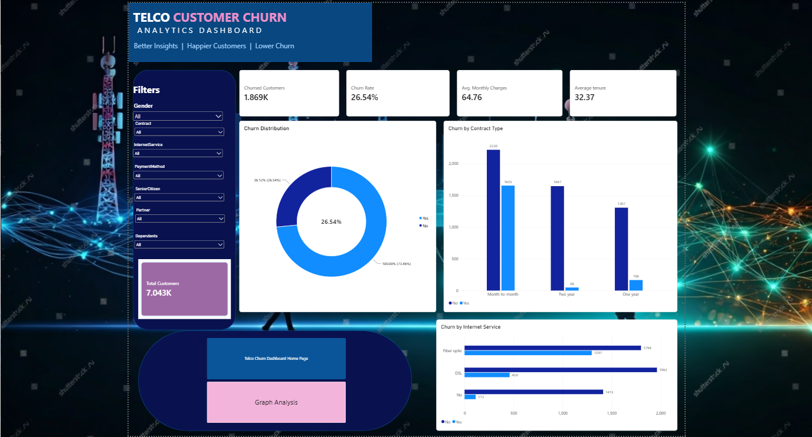
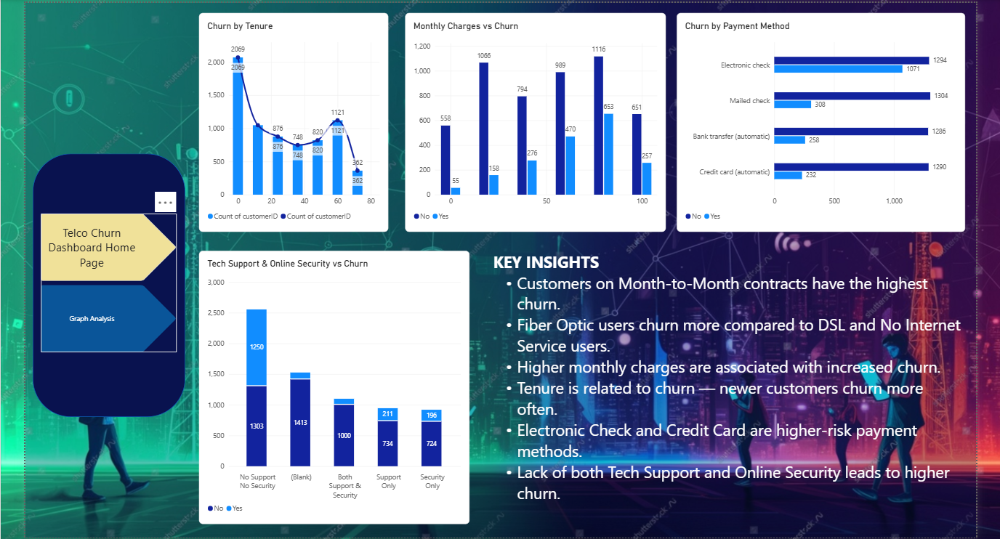

# Telco Customer Churn Analysis

A Power BI dashboard project exploring customer churn patterns in the Telco Customer Churn dataset.

## 📊 Dashboard Preview

### 1. Telco Customer Churn — Home Dashboard

### 2. Telco Customer Churn — Graph Analysis

## 🔍 Key Insights

- Customers on month-to-month contracts show the highest churn.
- Fiber optic customers show comparatively high churn.
- Higher monthly charges are associated with increased churn.
- Newer customers tend to churn more often than longer-tenure customers.
- Payment method and support-service usage can help identify customer groups that may need attention.

## 🛠️ Tools Used

- Power BI — dashboard and visual analysis
- Python — data analysis
- Pandas — data manipulation
- Jupyter Notebook — exploratory data analysis

## 📁 Project Files

- `Telco Customer Churn.ipynb` — exploratory data analysis notebook
- `Telco Customer Churn Dashboard.pbix` — Power BI dashboard file
- `dashboard-home.png` — home dashboard screenshot
- `dashboard-analysis.png` — graph analysis screenshot

## ▶️ How to View the Dashboard

1. Download `Telco Customer Churn Dashboard.pbix` from this repository.
2. Open it using Microsoft Power BI Desktop.
3. Use the available filters to explore churn patterns.

---
*Created as a customer churn analysis and dashboard project.*
